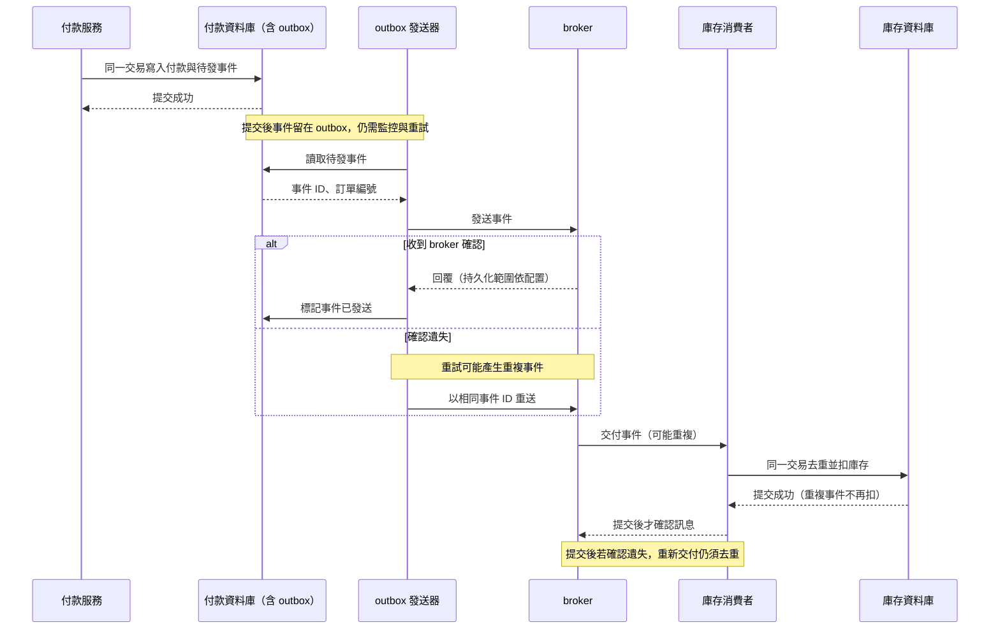

# 訊息佇列可靠性

**問題**：付款完成後，庫存服務沒有收到扣庫存訊息，或收到兩次。這可能造成超賣或重複扣庫存。

**原因**：生產者可能在送出後、收到確認前斷線；broker 可能故障；消費者可能在完成工作後、確認訊息前當機。重試能減少遺失，卻可能造成重複。

**防護**：

1. 生產者確認 broker 的回覆代表已寫入、持久化，還是已由多個複本確認。必要時重試，並處理「送出成功但確認遺失」的情況。
2. 依產品配置持久化、複本與故障切換。分區能分攤負載，但不等於有備援；複本也不能取代可還原的備份。
3. 消費者處理成功後才確認；失敗時退避重試，超過次數後送入死信佇列（DLQ，Dead-Letter Queue）供調查。
4. 以訂單編號做冪等處理：同一筆扣庫存請求執行兩次，最終仍只扣一次。

監控積壓量、失敗率、重試與死信。用節點故障及斷線演練驗證，而非只檢查設定檔。

## 逐段追蹤付款事件

付款資料庫提交後，若程式在發送訊息前當機，可以用交易式 outbox 在同一資料庫交易寫入待發事件；若 broker 已收到卻沒回確認，重送可能產生兩筆相同事件。消費者要用事件 ID 或訂單編號去重，並在提交庫存變更後才確認訊息。

- 漏訊風險：outbox 與重試降低漏發，但必須監控未送出事件。
- 重複風險：冪等消費或資料庫唯一約束避免重複扣減；僅靠 broker 確認不足。
- 長期失敗：有限重試、死信與人工補償；無限重試可能卡住後續工作。

參考：[Apache Kafka：Design](https://kafka.apache.org/documentation/#design)。

## 相關筆記

- [[訊息交付保證]]
- [[消費模式]]
- [[基本原理]]
