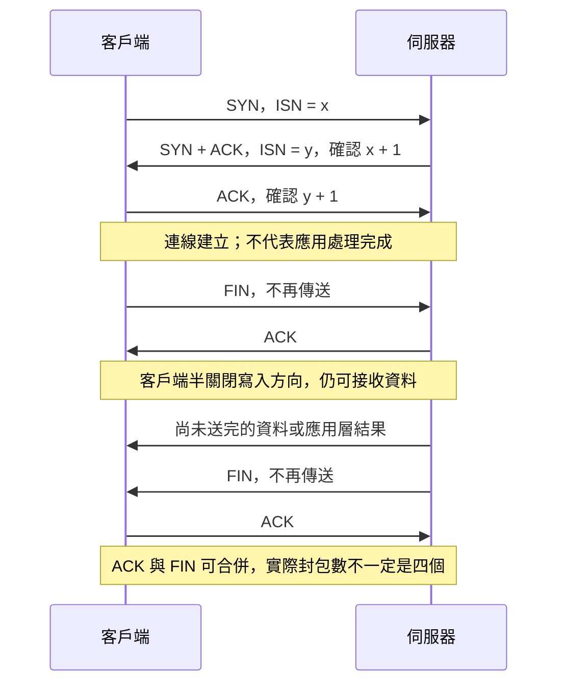

# TCP 連線建立與關閉

傳輸控制協定（TCP，Transmission Control Protocol）建立連線時，雙方交換初始序號並建立狀態。可靠傳輸還依賴連線建立後的確認與重傳，不能只靠握手。

## 建立：三次握手

1. 客戶端送出 **SYN（Synchronize）**，帶自己的初始序號（ISN，Initial Sequence Number）。
2. 伺服器回覆 **SYN + ACK（Acknowledgment）**，帶自己的 ISN，並確認客戶端的 ISN + 1。
3. 客戶端回覆 **ACK**，確認伺服器的 ISN + 1。雙方此時可開始傳資料。

可想成「我想連線」「收到，你聽得到我嗎？」「聽得到」。握手建立雙方的連線狀態與序號起點，降低舊連線封包被當成新資料的風險；不表示應用已完成任何業務處理。

## 關閉：雙方各自停止傳送

常見流程是 **FIN（Finish）→ ACK → FIN → ACK**：

1. 主動關閉的一方送 FIN，表示自己不再傳送資料。
2. 另一方送 ACK；仍可繼續傳送尚未完成的資料。
3. 另一方送 FIN，表示也不再傳送資料。
4. 主動關閉的一方送 ACK，確認最後的 FIN。

ACK 與 FIN 可以合併，所以實際封包數不一定恰好四個。主動關閉的一方通常會短暫留在 `TIME_WAIT`，處理延遲封包與最後 ACK 重傳；它不是「伺服器剛收到 SYN 時的狀態」。

例如檔案上傳時，客戶端送 FIN 只表示不再送位元組；伺服器仍可能正在寫檔。若要顯示「上傳成功」，應等待應用層的處理結果，不能只看 TCP 關閉流程。

### 雙端時序示意

## 實務上怎麼處理？

- 服務遇到大量半開連線：先量測 `SYN`、`SYN-ACK`、連線佇列與上游容量；可用平台提供的 SYN cookies 或上游流量防護，不能只調大應用程序數。
- 程式呼叫 `close` 後立刻重啟卻看到 `TIME_WAIT`：先釐清由哪端主動關閉、連線數及是否可安全重用，別把 `TIME_WAIT` 當成每次都要關掉的錯誤。
- 若一方傳完請求仍要讀回應，可半關閉寫入方向，等對方完成回應後再關閉讀取方向。

握手建立的是傳輸狀態，故障恢復及「是否扣款成功」仍需應用層查詢或冪等設計。

參考：[RFC 9293：TCP](https://www.rfc-editor.org/rfc/rfc9293)。

## 相關筆記

- [[TCP 與 UDP]]
- [[TCP 序號與確認]]
