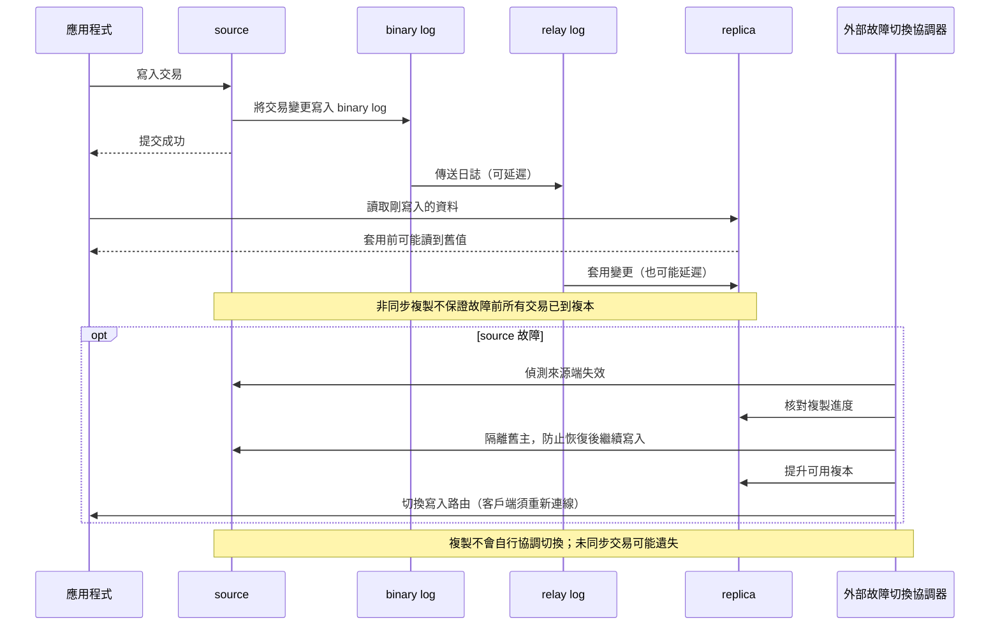

# 主從複製與故障切換

來源端（source）把寫入記錄到二進位日誌（binary log）。複本（replica）接收後寫入中繼日誌（relay log），再套用變更。可用全域交易識別碼（GTID，Global Transaction Identifier）追蹤複製位置；版本須符合官方相容條件，不要求絕對相同。

**問題**：商品剛下單，使用者在訂單頁卻看不到。原因可能是讀請求送到尚未套用最新變更的複本。非同步複製也可能在來源端故障時，遺失尚未同步的交易。

**處理**：

- 讀寫分離時，對「寫完立刻讀」的要求安排讀來源端，或設計等待複本追上進度。
- 故障切換要偵測來源端失效、選出可提升複本、切換寫入路由，並防止舊主節點繼續接受寫入。複製本身不會自動完成這些步驟。
- 監控複製延遲、狀態與 binary log 保留空間；演練切換後的資料差異。

**複本不是備份**：誤刪也會被複製。另做可還原備份並定期演練。

參考：[MySQL 8.4：Replication](https://dev.mysql.com/doc/refman/8.4/en/replication.html)。

## 兩種讀取與切換策略

- 訂單「剛寫完必須立刻看見」：讓讀請求回來源端，或等待複本追到已提交位置；後者要處理等待逾時，前者會增加主節點讀取負載。
- 每日統計容忍幾秒延遲：可讀複本減少主節點負載，但畫面要避免宣稱資料即時。
- 來源端故障：人工切換較易逐項核對但復原慢；自動切換較快，卻須驗證複本落後、舊主節點隔離與客戶端重新連線。

先定義可接受的復原時間與資料遺失範圍，再用故障演練測試，而不是只檢查有幾台複本。

## 相關筆記

- [[高可用性設計]]
- [[05 複製]]
