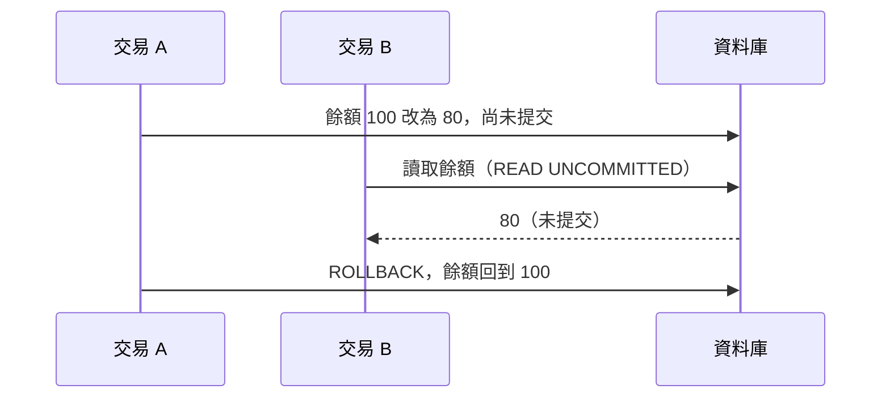
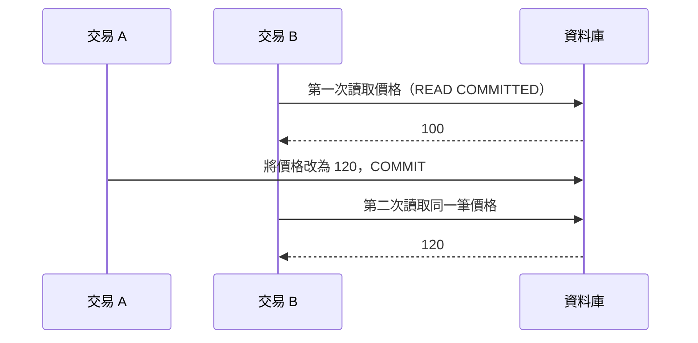
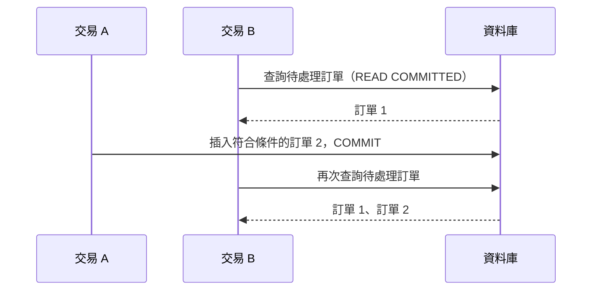
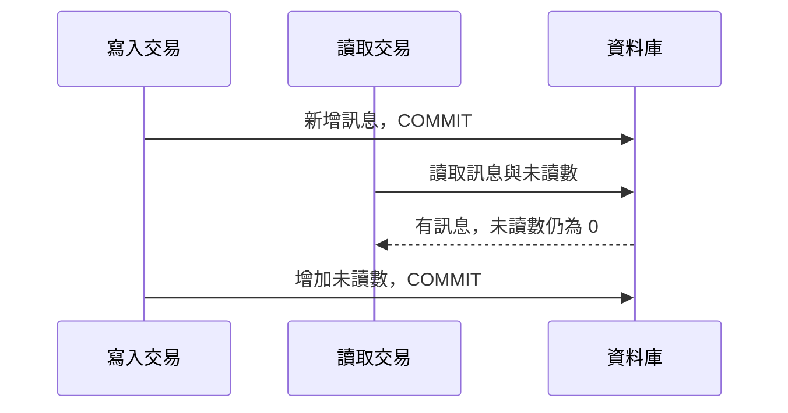

# 交易併發異常

多筆交易同時讀寫時，可能看到意料外的資料。以下以銀行餘額與訂單為例；是否真的出現，取決於資料庫、隔離層級與讀取方式。

## 髒讀（Dirty Read）

**問題**：交易 B 讀到交易 A 尚未提交的餘額。即使 A 最後提交，B 讀到當時未提交的值仍叫髒讀；若 A 回滾，B 的判斷就依賴了不存在的值。InnoDB 的 `READ UNCOMMITTED` 可能出現。避免依賴未提交資料。

## 不可重複讀（Non-repeatable Read）

**問題**：同一交易兩次讀同一筆價格，中間另一交易修改並提交，兩次得到不同值。`READ COMMITTED` 的普通 `SELECT` 可能發生。若計算必須以一致的資料為基礎，選適合的隔離方式或鎖定讀取。

## 幻讀（Phantom Read）

**問題**：同一條件兩次查詢訂單，另一交易插入符合條件的資料，結果多出資料列。InnoDB 的 `REPEATABLE READ` 普通一致性讀取沿用快照，不會因他人新提交的資料產生這種幻讀；鎖定讀取、寫入及自身寫入須分開分析。`SERIALIZABLE` 也不能說成允許幻讀。

## 交易時序的文字版

| 異常 | 交易 A | 交易 B | 判斷重點 |
| --- | --- | --- | --- |
| 髒讀 | 寫入餘額 80，尚未提交，之後回滾 | 在 A 提交前讀到 80 | 讀到未提交值 |
| 不可重複讀 | B 兩次讀取之間改價格 100 → 120 並提交 | 先讀 100、再讀 120 | 同一筆已提交資料被更新 |
| 幻讀 | B 兩次查詢之間插入一筆符合條件的訂單並提交 | 同一條件第二次多出一筆 | 結果集合增添符合條件的列 |

以上是概念時序，不保證每種資料庫與隔離設定都會允許異常；尤其 InnoDB 快照讀取與鎖定讀取不可混談。

## 跨資料表的中間狀態

若「新增訊息」與「增加未讀數」分兩次提交，讀者可能看到有訊息卻沒有未讀數。把需要一起成功的寫入放在同一交易；再依讀取需求選隔離方式。**這是已提交寫入間的中間狀態，不等於髒讀**。

另一個跨表例子是商品買家與發票收件人分開寫入，最後兩欄對不上。若操作分別提交，讀者可能看到不一致，或競爭寫入造成更新遺失。應將需要一致的欄位納入同一交易並檢查併發；若都在同一 InnoDB 交易且更新同一列，鎖可能阻止這種交錯，不能只憑沒有提交邊界的示意圖斷定異常會發生。

參考：[MySQL 8.4：InnoDB 隔離層級](https://dev.mysql.com/doc/refman/8.4/en/innodb-transaction-isolation-levels.html)。

## 如何處理？

一致快照可避免普通讀取的部分重讀差異；鎖定讀取或條件式更新可保護要修改的資料；業務唯一約束擋住重複處理。先確認使用的資料庫、隔離層級和語句類型。

## 相關筆記

- [[交易隔離層級]]
