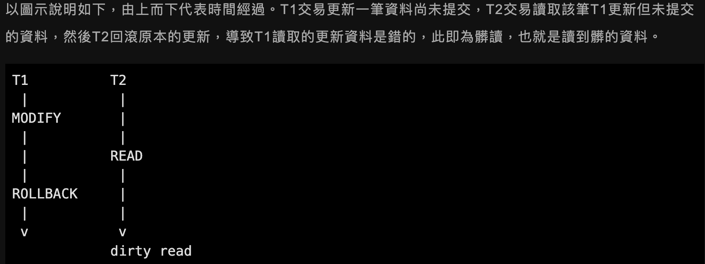
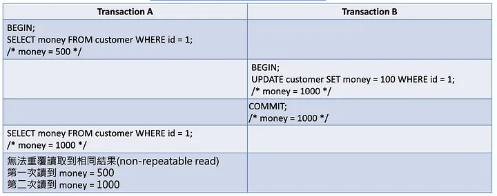
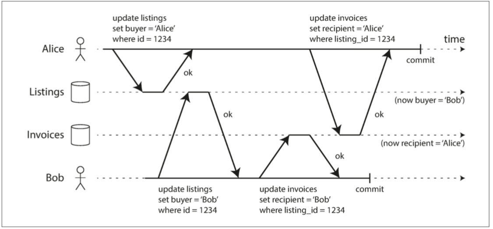
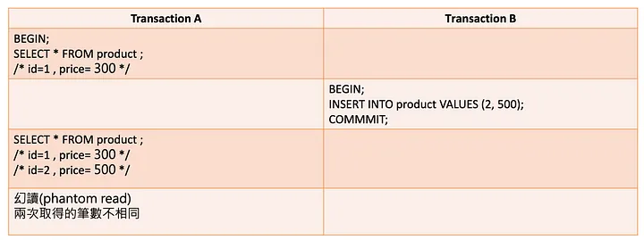
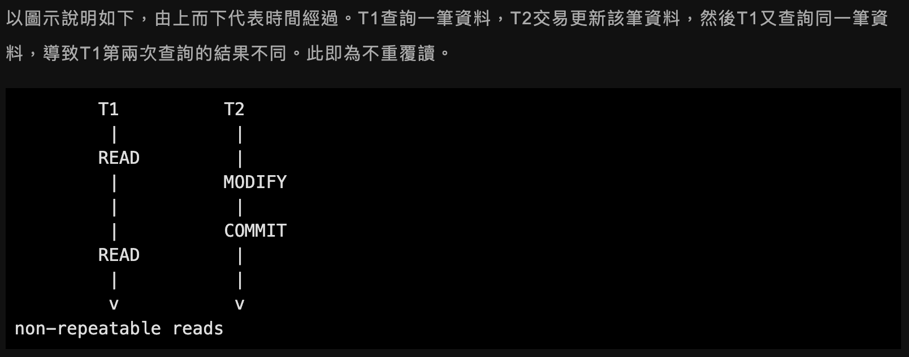
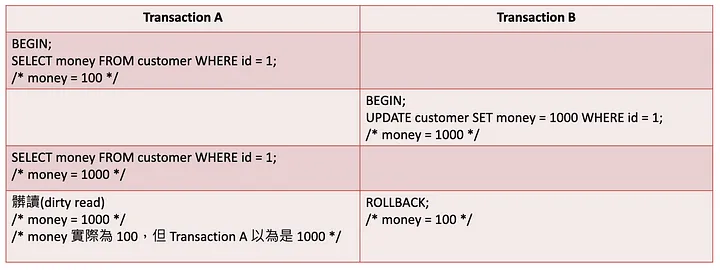

# 交易併發異常

多筆交易同時讀寫時，可能看到意料外的資料。以下以銀行餘額與訂單為例；是否真的出現，取決於資料庫、隔離層級與讀取方式。

## 髒讀（Dirty Read）

**問題**：交易 B 讀到交易 A 尚未提交的餘額。即使 A 最後提交，B 讀到當時未提交的值仍叫髒讀；若 A 回滾，B 的判斷就依賴了不存在的值。InnoDB 的 `READ UNCOMMITTED` 可能出現。避免依賴未提交資料。

## 不可重複讀（Non-repeatable Read）

**問題**：同一交易兩次讀同一筆價格，中間另一交易修改並提交，兩次得到不同值。`READ COMMITTED` 的普通 `SELECT` 可能發生。若計算必須以一致的資料為基礎，選適合的隔離方式或鎖定讀取。

## 幻讀（Phantom Read）

**問題**：同一條件兩次查詢訂單，另一交易插入符合條件的資料，結果多出資料列。InnoDB 的 `REPEATABLE READ` 普通一致性讀取沿用快照，不會因他人新提交的資料產生這種幻讀；鎖定讀取、寫入及自身寫入須分開分析。`SERIALIZABLE` 也不能說成允許幻讀。

## 跨資料表的中間狀態

若「新增訊息」與「增加未讀數」分兩次提交，讀者可能看到有訊息卻沒有未讀數。把需要一起成功的寫入放在同一交易；再依讀取需求選隔離方式。下圖未標示提交邊界，**不能**僅憑圖片判定為髒讀。

參考：[MySQL 8.4：InnoDB 隔離層級](https://dev.mysql.com/doc/refman/8.4/en/innodb-transaction-isolation-levels.html)。

## 相關筆記

- [[交易隔離層級]]
