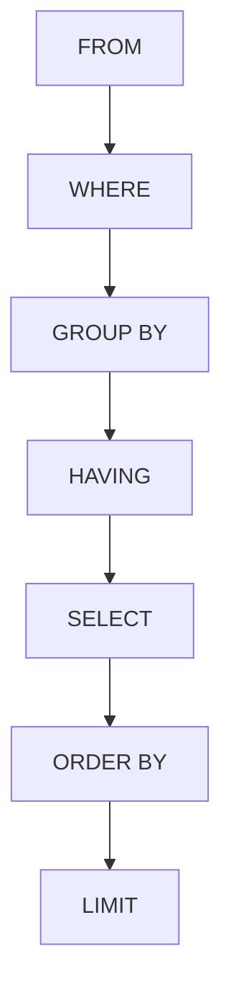

# 查詢邏輯處理順序

SQL（Structured Query Language，結構化查詢語言）的撰寫順序，不等於理解結果時的**邏輯處理順序**：

1. `FROM`：決定來源表與關聯資料。
2. `WHERE`：先篩選個別資料列。
3. `GROUP BY`：將符合條件的列分組並計算聚合值。
4. `HAVING`：再篩選分組結果。
5. `SELECT`：決定輸出欄位與運算結果。
6. `ORDER BY`：排序結果。
7. `LIMIT`：取指定數量的列。

下圖是理解結果的**邏輯順序，不是資料庫的物理執行順序**：



例如想找「訂單數超過 10 筆的顧客」，要先按顧客分組，再用 `HAVING COUNT(*) > 10` 篩選。`WHERE` 用於分組前的單列條件，不適合直接篩選這個聚合結果。

**這不是資料庫逐行執行的物理順序**。MySQL 優化器可以調整實際存取與關聯順序；要排查效能，使用 `EXPLAIN` 看執行計畫。

## 以顧客訂單做一次推導

```sql
SELECT customer_id, COUNT(*) AS orders
FROM orders
WHERE status = 'paid'
GROUP BY customer_id
HAVING COUNT(*) > 10
ORDER BY orders DESC
LIMIT 5;
```

先排除未付款列，再以顧客分組、只留超過 10 筆者，最後按筆數排序取前五。若把 `COUNT(*) > 10` 放在 `WHERE`，此時還沒形成分組結果；若要在「付款日」篩選，應在 `WHERE` 寫可利用索引的條件。

理解結果靠邏輯順序；改善效能靠實際執行計畫。兩者用途不同。

參考：[MySQL 8.4：SELECT](https://dev.mysql.com/doc/refman/8.4/en/select.html)。

## 相關筆記

- [[查詢最佳化]]
