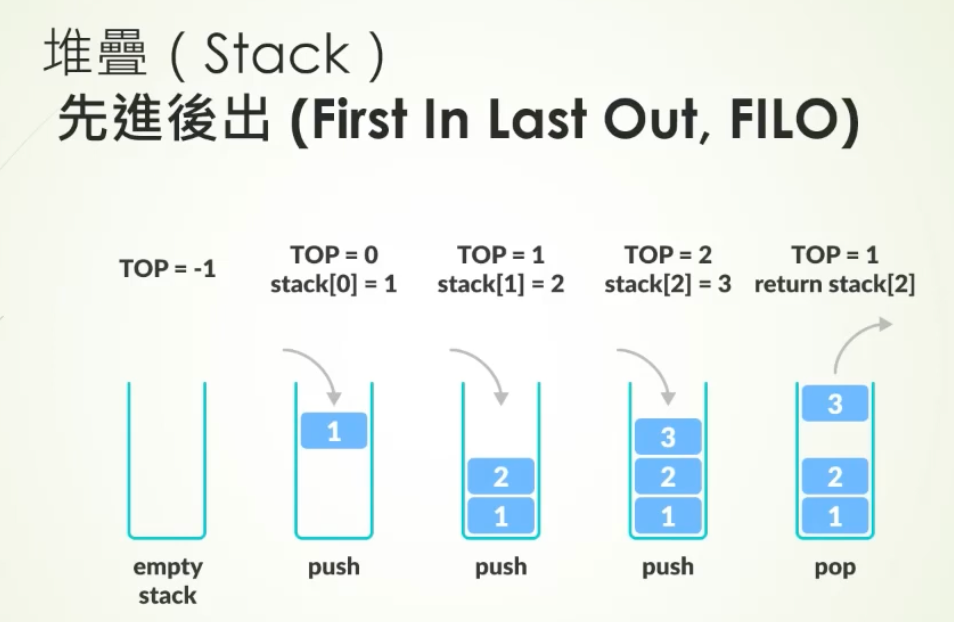

# 堆疊與佇列

兩者都保存待處理項目，差別在**下一個取出誰**。

## 堆疊（Stack）：後進先出（LIFO，Last In, First Out）

只能從頂端放入 `push`、取出 `pop`。像疊盤子，最後放上去的先取走。函式呼叫會用堆疊記住「執行完要回哪裡」。查看頂端、放入與取出通常是 O(1)；若用動態陣列，擴容那一次可能是 O(n)。找任意項目仍是 O(n)。

## 佇列（Queue）：先進先出（FIFO，First In, First Out）

從尾端加入 `enqueue`、前端取出 `dequeue`。像櫃檯排隊，先到的先服務。鏈結串列或環狀緩衝區能讓兩端操作 O(1)；若用陣列移動所有項目來刪除第一項，單次可能 O(n)。找任意項目仍是 O(n)。

## 相關筆記

- [[陣列與鏈結串列]]
