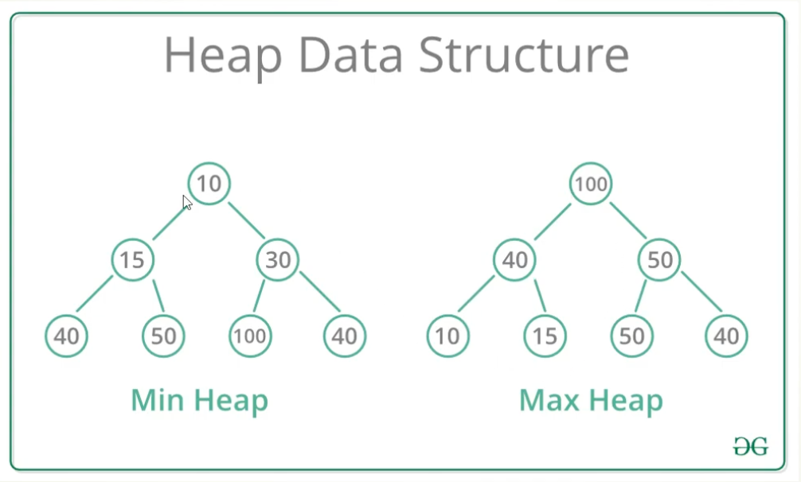

# 堆與優先佇列

**優先佇列（Priority Queue）**不按排隊先後，而是先取出優先級最高的項目。**二元堆積（Binary Heap）**是常見實作，通常用陣列表示一棵完全二元樹。

- **最小堆（Min Heap）**：父節點不大於子節點，根是最小值。
- **最大堆（Max Heap）**：父節點不小於子節點，根是最大值；堆排序常用最大堆。

| 操作 | 二元堆積成本 |
| --- | --- |
| 看根節點 | O(1) |
| 插入並向上調整 | O(log n) |
| 移除根並向下調整 | O(log n) |
| 尋找任意指定值 | O(n) |

例如客服系統先處理緊急工單，可用優先佇列反覆取出最高優先級項目。**堆不是完整排序的陣列**；圖上寫「看資料 O(1)」只適用看根。Dijkstra 最短路徑也常使用優先佇列；更新優先級的方式依實作而異。

## 相關筆記

- [[樹與圖]]
- [[時間與空間複雜度]]
