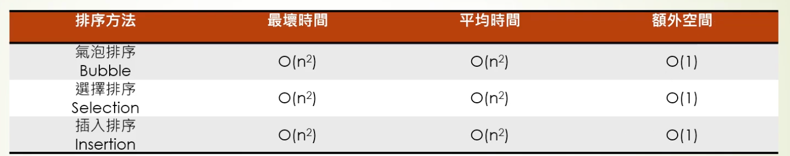

# 時間與空間複雜度

複雜度描述**輸入規模 n 增加時，資源用量如何成長**，不是程式會跑幾秒。時間複雜度看操作量，空間複雜度看額外記憶體；實測還受硬體與實作影響。

| 表示法 | 成長方式 | 例子 |
| --- | --- | --- |
| O(1) | 不隨 n 增加的固定次數操作 | 陣列按索引讀取 |
| O(log n) | 規模增加一倍，操作只增加少量 | 已排序陣列的二分搜尋 |
| O(n) | 規模增加一倍，操作約增加一倍 | 從頭掃描陣列 |
| O(n log n) | 比線性快些成長 | 常見比較排序的平均或最壞情況 |
| O(n²) | 規模增加一倍，操作約變四倍 | 比較每對元素 |
| O(2ⁿ) | 規模略增就急劇增加 | 枚舉所有子集合 |

**空間例子**：只用幾個計數器是 O(1) 額外空間；另開一份長度為 n 的結果陣列是 O(n)。要先說明是否把輸入、輸出與遞迴呼叫堆疊算進去。

## 常見結構的條件

| 操作 | 陣列 | 二元搜尋樹（BST，Binary Search Tree） | 雜湊表 |
| --- | --- | --- | --- |
| 找指定值 | O(n)；已排序且可隨機存取時可二分搜尋 | 平衡時 O(log n)，退化時 O(n) | 平均 O(1)，極端碰撞時可能 O(n) |
| 插入／刪除 | 中間位置通常 O(n)；尾端插入可攤銷 O(1) | 平衡時 O(log n)，退化時 O(n) | 平均 O(1)，擴容那次可能較慢 |

例如十萬筆資料要反覆依編號查人，從頭掃描每次 O(n)；用合適的雜湊表，平均可降到 O(1)。但「平均」不等於每次都固定快。複雜度幫助挑方向，最後仍需量測。

## 排序法時間複雜度

下圖比較不同排序法；同一演算法的最佳、平均與最壞情況可能不同。

## 相關筆記

- [[堆與優先佇列]]
- [[陣列與鏈結串列]]
