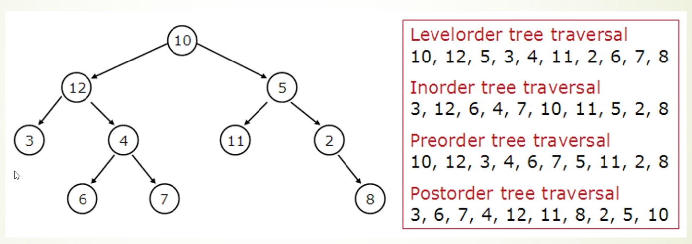

# 樹與圖

**樹（Tree）**像有層級的資料夾，每個節點可連到下一層；**圖（Graph）**則允許更一般的節點與邊，例如道路或社交關係。

## 樹與查找

- **二元樹（Binary Tree）**：每個節點最多有兩個子節點；不一定有排序規則。
- **二元搜尋樹（BST，Binary Search Tree）**：左子樹的鍵小於節點，右子樹的鍵大於節點；重複鍵如何放依實作而定。
- **AVL 樹（AVL Tree）與紅黑樹（Red-Black Tree）**：自平衡搜尋樹，讓查找、插入與刪除保持 O(log n)；更新時須維持平衡。C++ 標準函式庫的 `map`、`set` 常用紅黑樹實作，但標準不強制指定結構。

下圖是**一般二元樹**的遍歷示意，不是 BST：左子節點 12 大於根 10。

BST 平衡時查找約 O(log n)；退化成鏈狀時最壞 O(n)。下圖標示的 O(log n) 只在高度受控時成立。

## 圖的走訪

- **深度優先搜尋（DFS，Depth-First Search）**：沿一條路走到底再回頭；常用遞迴或堆疊。可用於走訪、拓樸排序等。
- **廣度優先搜尋（BFS，Breadth-First Search）**：先看鄰近節點，再逐層往外；常用佇列。在**無權重**圖中可找最少邊數的路徑。

例如導航若每條路耗時不同，不能只用 BFS 找最快路；可考慮 Dijkstra 等帶權重的演算法。圖走訪要記錄已訪問節點，避免在環中一直繞。

## 相關筆記

- [[堆與優先佇列]]
- [[堆疊與佇列]]
