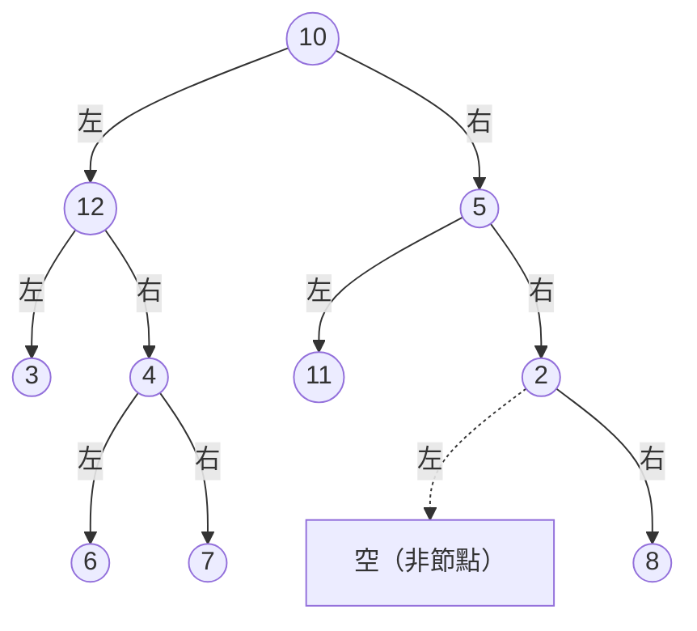

# 樹與圖

**樹（Tree）**像有層級的資料夾，每個節點可連到下一層；**圖（Graph）**則允許更一般的節點與邊，例如道路或社交關係。

## 樹與查找

- **二元樹（Binary Tree）**：每個節點最多有兩個子節點；不一定有排序規則。
- **二元搜尋樹（BST，Binary Search Tree）**：左子樹的鍵小於節點，右子樹的鍵大於節點；重複鍵如何放依實作而定。
- **AVL 樹（AVL Tree）與紅黑樹（Red-Black Tree）**：自平衡搜尋樹，讓查找、插入與刪除保持 O(log n)；更新時須維持平衡。C++ 標準函式庫的 `map`、`set` 常用紅黑樹實作，但標準不強制指定結構。

下方「走訪順序與選法」以**一般二元樹**為例：左子節點 12 大於根 10，因此不是 BST。

BST 高度受控時查找、插入與刪除約 O(log n)；依序插入 `1, 2, 3, 4, 5` 且不自動平衡時，可能退化成 `1 → 2 → 3 → 4 → 5`，最壞 O(n)。

## 圖的走訪

- **深度優先搜尋（DFS，Depth-First Search）**：沿一條路走到底再回頭；常用遞迴或堆疊。可用於走訪、拓樸排序等。
- **廣度優先搜尋（BFS，Breadth-First Search）**：先看鄰近節點，再逐層往外；常用佇列。在**無權重**圖中可找最少邊數的路徑。

例如導航若每條路耗時不同，不能只用 BFS 找最快路；可考慮 Dijkstra 等帶權重的演算法。圖走訪要記錄已訪問節點，避免在環中一直繞。

## 走訪順序與選法

例如這棵樹可用括號記法寫成 `10(12(3, 4(6, 7)), 5(11, 2(空, 8)))`，括號內依序是左、右子樹。這棵樹**不是** BST，因為 `12 > 10` 卻位於根的左側。

| 遍歷 | 這棵樹的訪問順序 | 做法 |
| --- | --- | --- |
| 層序（Level-order） | 10, 12, 5, 3, 4, 11, 2, 6, 7, 8 | 佇列，逐層訪問 |
| 中序（In-order） | 3, 12, 6, 4, 7, 10, 11, 5, 2, 8 | 左子樹、節點、右子樹 |
| 前序（Pre-order） | 10, 12, 3, 4, 6, 7, 5, 11, 2, 8 | 節點、左子樹、右子樹 |
| 後序（Post-order） | 3, 6, 7, 4, 12, 11, 8, 2, 5, 10 | 左子樹、右子樹、節點 |

例如檔案夾要逐層顯示時可用 BFS；要先處理完子資料夾再刪父資料夾時可用 DFS 後序。若要按鍵做快速、有序查找，選**自平衡** BST；普通 BST 在遞增插入時可能退化。

參考：[Open Data Structures：Binary Trees](https://opendatastructures.org/ods-python/)。

## 相關筆記

- [[堆與優先佇列]]
- [[堆疊與佇列]]
