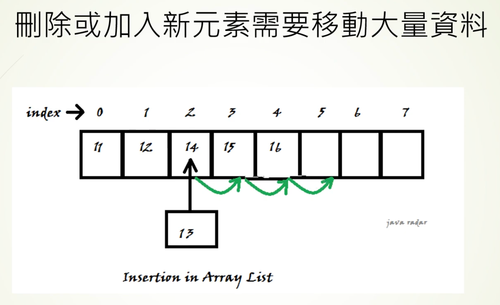

# 陣列與鏈結串列

陣列（Array）把元素連續存放；鏈結串列（Linked List）靠節點的指標串接。選擇前，分清楚「找到位置」與「在已知位置修改」。

| 操作 | 陣列 | 鏈結串列 |
| --- | --- | --- |
| 按索引讀取、修改 | O(1) | O(n)，需走訪 |
| 搜尋指定值 | O(n) | O(n) |
| 中間插入、刪除 | 通常 O(n)，需搬移元素 | 已知節點及前一節點時 O(1)；找位置仍 O(n) |
| 空間 | 連續配置，預留容量可能閒置 | 不要求連續配置，但每個節點多佔指標空間 |

例如要頻繁讀取第 100 項，陣列可直接定位；鏈結串列要從已知節點一路往後找。若已握有某節點及其前一節點，頻繁插入時鏈結串列才可能省去搬移。固定陣列無法直接擴容；動態陣列擴容時須複製元素。堆疊與佇列也能用陣列實作。

## 陣列示意

## 鏈結串列示意

## 比較與複雜度圖

圖上「插入快」以已知位置為前提；找位置仍需 O(n)。

## 相關筆記

- [[堆疊與佇列]]
- [[時間與空間複雜度]]
