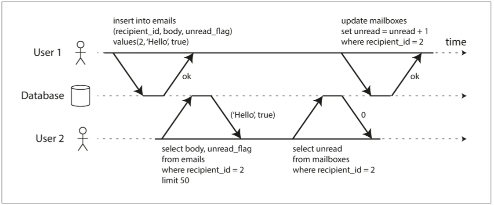

# DDIA 07：交易

交易讓一組讀寫有明確的成功或失敗邊界。例如轉帳不應只扣 A 的錢，卻沒增加 B 的餘額。

- **原子性（Atomicity）**：交易中止時，不留下部分寫入。
- **一致性（Consistency）**：資料須符合應用定義的約束。資料庫能檢查部分規則，其他業務規則仍由應用負責。
- **隔離性（Isolation）**：多筆交易並行時的可見性，依隔離層級而異；不代表完全互不干擾。
- **持久性（Durability）**：確認提交後，在系統承諾的故障模型下可恢復；仍需備份處理儲存與副本全毀。

## 讀寫異常

**髒讀（Dirty Read）**：讀到另一筆交易尚未提交的寫入。即使對方之後提交，當時讀到的仍是未提交資料。

**髒寫（Dirty Write）**：覆寫另一筆交易尚未提交的寫入。這會讓回滾變得難以正確處理，與髒讀不同。

遇到並行交易問題時，先確認是讀到什麼、何時提交，再選隔離層級與業務檢查；不要把所有異常都叫髒讀。

## 相關筆記

- [[轉帳與 ACID]]
